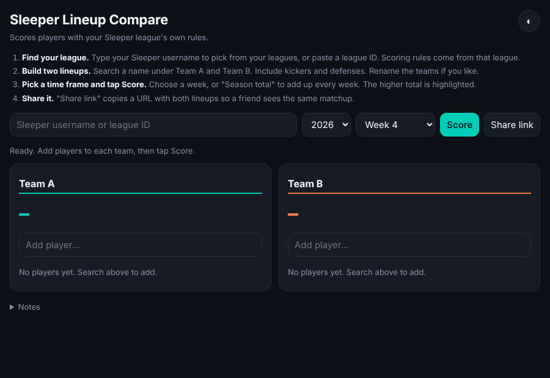

# Sleeper Lineup Compare

Compare two fantasy football lineups using your Sleeper league's own scoring rules.

Live: https://d34fwrzw00qko0.cloudfront.net

Pick any players for Team A and Team B, choose a season and week (or a season total), and the page scores both lineups with your league's real scoring settings. Defenses and kickers are included. The "Share link" button encodes both lineups into the URL so a friend sees the same matchup.

## How it works

- One static page, no build step and no dependencies: `web/index.html`, `web/styles.css`, and ES modules (`web/app.js` is the entry point, with the pieces in `web/js/`: Sleeper API, player cache, scoring, team rendering, league lookup, share links, theme).
- Enter a Sleeper username (or a league ID) and pick a league if there is more than one. Team A fills with that manager's starters and Team B with their opponent for the chosen week, and scores update automatically. Each team also has a "Fill from a league manager" list, and typing a username or team name as a team's name fills it too. Untick "Autofill" to stop the automatic fill. There is no default league.
- Typing a username in the top box also fills Team A once a league is chosen, and typing a username (or a team name from the loaded league) as a team's name fills that team. Untick "Autofill" to turn this off. With a league loaded it uses that league; otherwise it uses the user's only league that season.
- Data comes live from the public [Sleeper API](https://docs.sleeper.com/) (league scoring, player list, weekly stats). No keys needed.
- The player list is cached in `localStorage` for a day. Lineups and preferences are saved there too.
- Share links keep state in the URL hash (`#d=...`), so nothing is sent to a server.

## Deploy

Hosted on private S3 behind CloudFront. The stack is plain CloudFormation in the infra repo; pushing to `main` runs `.github/workflows/deploy.yml`, which syncs `web/` using a GitHub OIDC role, with no stored keys.

## Run locally

Browsers block ES modules on `file://`, so serve it: `python3 -m http.server -d web`, then open http://localhost:8000.

## History

Started as `ubiquitous-octo-journey`. Its old GitHub Pages address now redirects here and keeps share-link data.
